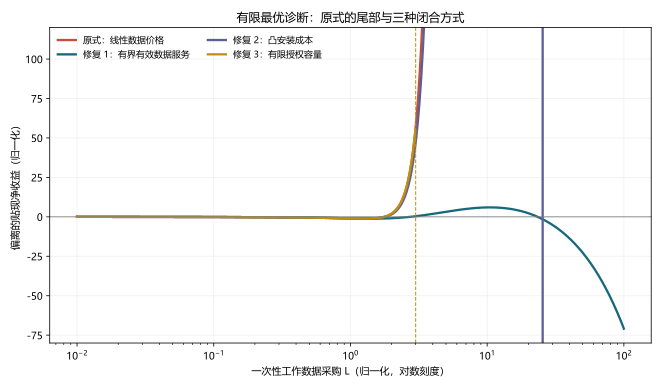

# 有限最优的独立复核：原文合同、企业测度、价格口径与三种修复

## 结论先行

独立复核确认了原解析的条件性判断，而且开放经济也存在同类问题：

- 原文附录明确让每个中间品企业选择连续工作数据流量 $\varphi_t$，并支付线性支出 $P_{\varphi,t}\varphi_t$；没有在该优化问题中写采购上限、固定数据包或凸安装成本。
- 单位测度的企业和数据非竞争性只说明对称聚合方式，不会自动限制某个企业的可行选择。
- 在封闭经济中，企业优化商品产量后的经营利润按 $\Phi^{\alpha\xi(\rho-1)}$ 增长；基准值给出指数 $20/3>1$。
- 在开放经济中，对两个销售目的地的优化使用弹性 $m$，经营利润至少按 $\Phi^{\alpha\xi(m-1)}$ 增长；基准值给出 $4/3>1$。
- 因此，在**给定正价格、正需求、企业可无限连续采购**的原文字面问题中，线性采购成本不能压住超线性未来收益，企业价值没有有限最大值。

这个结论不等于作者有意主张企业可以购买无限个彼此不同的数据包。正文“所有企业购买相同数据”也可以理解为数据商生产一个有限数据集并向所有企业授权。但是，一旦采用共同数据包解释，就必须把容量或许可合同写入企业选择集，并相应改写价格条件。现有附录同时使用“相同数据”和“企业连续选择任意数量”的写法，留下了需要闭合的合同缺口。

本项目建议把**有界有效数据服务**作为基准修复：它保留原稳态附近的数据弹性，同时让新增数据的生产率收益逐渐饱和。有限数据包适合研究授权制度，凸安装成本适合作为数值稳健性检查。

---

## 1. 先回到原文，而不是从既有解析倒推

### 1.1 正文对数据非竞争性的表述

NBER 2025 修订版第 8 页写道：每个中间品企业购买工作数据；由于数据非竞争且企业同质，每个企业购买相同数据，所以作者省略 $\varphi_t$ 的企业下标。脚注 8 又说明，流量工作数据在企业间非竞争，而企业积累的 $\Phi_{i,t}$ 是有企业下标的数据状态。

这段话能支持两种不同合同解释：

1. **连续数量解释：**每家企业可按单位价格选择任意 $\varphi_{i,t}\ge0$，对称均衡中选择相同数量。
2. **共同数据包解释：**数据商生产一个大小为 $\bar\varphi_t$ 的数据包，企业只能购买访问权或选择不超过该包的使用强度。

两种解释在对称点可能产生相同数量，却有不同的单企业偏离集合。判断最优是否存在，必须看附录实际写出的选择集。

### 1.2 附录写的是连续数量选择

Appendix A.1 的中间品企业问题把 $\varphi_{i,t}$ 列为选择变量，利润逐期扣除

$$
P_{\varphi,t}\varphi_{i,t}.
$$

数据状态按

$$
\Phi_{i,t+1}=(1-\delta_\Phi)\Phi_{i,t}+\varphi_{i,t}
$$

更新。Appendix A.2 在开放经济中先让企业从本国和外国两种来源选择数据，再让企业在动态利润问题中选择复合工作数据 $\varphi_t$。附录没有写 $\varphi_{i,t}\le\bar\varphi_t$，也没有固定接入费、非线性价目表或安装成本。

数据商收入为

$$
\int_0^1P_{i,\varphi,t}\varphi_{i,t}\,di.
$$

在对称均衡中，单位测度使它等于 $P_{\varphi,t}\varphi_t$。这个积分说明 $P_{\varphi,t}$ 是每单位工作数据的企业端价格，而不是一项与数量无关的固定许可费。

所以，按照附录直接写出的优化问题，连续无上限解释是需要接受检验的对象。

## 2. 单位测度为什么不能排除偏离

每国有单位测度的垄断竞争企业，$i\in[0,1]$。单个企业的测度为零，所以它改变自己的采购不会改变总价格指数、工资、数据价格或总需求。这正是垄断竞争中求单企业最优时使用的价格接受环境。

单位测度只带来

$$
\int_0^1\varphi_{i,t}\,di=\varphi_t
$$

这一对称聚合结果。它没有推出 $\varphi_{i,t}$ 必须等于数据商总产量，也没有把单企业可行集缩成一个点。若单企业利润可以沿某个可行序列无限提高，对称的一阶条件仍不能构成竞争均衡。

非竞争性同样不是上限。它意味着同一工作数据可同时服务多个企业，不意味着每个企业获得的不同信息内容可以无限增加，也不意味着数据商能在不增加原始数据或加工劳动的情况下生产无限大的数据包。要让“相同数据包”承担容量约束，模型必须明确写出该数据包。

## 3. 封闭经济的指数推导

固定正的总需求 $Y$、工资 $w$、资本租金 $r$ 和数据价格 $P_\varphi$。最终品价格归一化为 1。中间品需求为

$$
y_i=p_i^{-\rho}Y,
$$

所以逆需求是

$$
p_i=Y^{1/\rho}y_i^{-1/\rho}.
$$

将生产函数写成

$$
y_i=A\Phi_i^{\alpha\xi}k_i^\alpha n_i^{1-\alpha}.
$$

给定 $\Phi_i$，成本最小化给出的单位成本为

$$
MC(\Phi_i)=c_0\Phi_i^{-\alpha\xi},
\qquad
c_0=\frac1A\left(\frac r\alpha\right)^\alpha
\left(\frac w{1-\alpha}\right)^{1-\alpha}>0.
$$

企业先对产量求解

$$
\max_{y_i\ge0}
Y^{1/\rho}y_i^{(\rho-1)/\rho}
-c_0\Phi_i^{-\alpha\xi}y_i.
$$

一阶条件为

$$
\frac{\rho-1}{\rho}Y^{1/\rho}y_i^{-1/\rho}
=c_0\Phi_i^{-\alpha\xi}.
$$

因此

$$
y_i^*(\Phi_i)
=\left[\frac{\rho-1}{\rho}\frac{Y^{1/\rho}}{c_0}\right]^\rho
\Phi_i^{\alpha\xi\rho}.
$$

最优点上，成本等于收入的 $(\rho-1)/\rho$，经营利润等于收入的 $1/\rho$。代回得到

$$
\boxed{\pi_i^{op}(\Phi_i)=C_\rho\Phi_i^\theta,
\qquad \theta=\alpha\xi(\rho-1),\quad C_\rho>0.}
$$

这一步只使用了原文需求、生产技术和成本最小化，没有使用稳态方程。

## 4. 一次性偏离证明无界

假设今天企业购买 $L$ 单位工作数据，之后可以不再采购。由于

$$
\Phi_{i,t+1}=(1-\delta_\Phi)\Phi_{i,t}+L\ge L,
$$

下一期经营利润至少为 $C_\rho L^\theta$。企业以后若遇到负经营收益可以不生产。今天采购支出为 $P_{\varphi,t}L$，故该偏离的贴现价值至少为

$$
-P_{\varphi,t}L+\beta C_\rho L^\theta.
$$

当 $\theta>1$ 时，第二项的增长阶数高于第一项：

$$
\lim_{L\to\infty}
\left[-P_{\varphi,t}L+\beta C_\rho L^\theta\right]=+\infty.
$$

所以企业问题没有有限最大值。基准校准

$$
\alpha=\frac13,
\qquad \xi=1,
\qquad \rho=21
$$

给出

$$
\theta=\frac13(21-1)=\frac{20}{3}>1.
$$

三种指数情形应分开：

- $\theta>1$ 时，贴现收益在尾部压过线性成本，目标函数无上界。
- $\theta=1$ 时，尾部是 $(-P_{\varphi,t}+\beta C_\rho)L$。若括号为正，问题仍无上界；若为负，线性成本控制尾部；若等于零，尾部变平，不能由这一项得到唯一有限解。
- $\theta<1$ 时，$-P_{\varphi,t}L$ 在尾部占优，因而排除这一无界偏离；完整动态问题仍需连续性、折现、状态边界和其他投入的可行性条件才能保证最大值存在。

这也解释了为什么求出一阶条件的正根不够。当 $\theta>1$ 时，归一化目标

$$
f(L)=-qL+\beta C L^\theta
$$

的正驻点满足 $q=\beta C\theta L^{\theta-1}$，但

$$
f''(L)=\beta C\theta(\theta-1)L^{\theta-2}>0.
$$

该驻点是局部最小值，不是有限最优。稳态数值算法收敛到一个一阶条件根，也不能推翻尾部偏离。

## 5. 开放经济检查并不会自动通过

开放经济中，中间品企业向本国和外国两个批发商销售。原文 Appendix A.2 的定价加成由商品来源替代弹性 $m$ 决定。固定两个市场的正需求规模，企业总收入可以写成若干正系数乘 $p^{1-m}$，最优价格仍是 $m/(m-1)$ 倍边际成本。

边际成本继续满足 $MC(\Phi)\propto\Phi^{-\alpha\xi}$，所以优化后的经营利润至少按

$$
\boxed{\pi^{op}_{open}(\Phi)
=C_m\Phi^{\alpha\xi(m-1)},\qquad C_m>0}
$$

增长。基准 $m=5$ 给出

$$
\alpha\xi(m-1)=\frac13(5-1)=\frac43>1.
$$

只要至少一个销售市场保持正需求，无上限线性采购仍有超线性偏离。开放经济的数据来源 CES 会决定取得一单位复合工作数据的价格，但在给定正来源价格下，该复合品成本仍对总数量一次齐次，不能单独解决尾部问题。

## 6. 三种修复

### 6.1 修复一：有界有效数据服务——推荐作为新基准

把原生产函数中的 $\Phi^\xi$ 替换为有效数据服务 $g(\Phi)$：

$$
Y_i=A[g(\Phi_i)k_i]^\alpha n_i^{1-\alpha}.
$$

选择一个在基准稳态 $\bar\Phi$ 保持原局部弹性、但长期饱和的函数：

$$
\boxed{
g(\Phi)=\bar g\exp\left\{
\frac\xi\kappa
\left[1-\left(\frac\Phi{\bar\Phi}\right)^{-\kappa}\right]
\right\},\qquad \kappa>0.
}
$$

它具有三项性质：

$$
g(\bar\Phi)=\bar g,
$$

$$
\frac{d\ln g}{d\ln\Phi}
=\xi\left(\frac\Phi{\bar\Phi}\right)^{-\kappa},
\qquad
\left.\frac{d\ln g}{d\ln\Phi}\right|_{\bar\Phi}=\xi,
$$

$$
\lim_{\Phi\to\infty}g(\Phi)=\bar g e^{\xi/\kappa}<\infty.
$$

因此，这一修复在原稳态附近保留作者希望由 $\xi$ 表示的数据弹性，但随着数据丰富度提高，边际有效信息下降。企业优化产量后的经营利润与 $g(\Phi)^{\alpha(\rho-1)}$ 成比例并且有界；而一次性数据采购成本仍线性趋于无穷，企业不会选择无限采购。

数据 Euler 只需要把固定 $\xi$ 换成状态依赖的有效数据弹性

$$
\varepsilon_g(\Phi)
\equiv\frac{d\ln g}{d\ln\Phi}.
$$

原来的数据边际产出项

$$
\alpha\xi MC_{t+1}\frac{Y_{i,t+1}}{\Phi_{i,t+1}}
$$

改为

$$
\boxed{
\alpha\varepsilon_g(\Phi_{i,t+1})MC_{t+1}
\frac{Y_{i,t+1}}{\Phi_{i,t+1}}.
}
$$

这个修复最适合做论文的新基准，因为它改变的是“数据数量如何成为有效生产服务”，而不是把非竞争性数据硬改成普通耗尽性投入。它也可以自然接到扩展 B 的数据质量和算力模块。

### 6.2 修复二：有限数据包或授权容量——适合合同解释

令数据商在每期生产一个大小为 $\bar\varphi_t$ 的共同数据包，并非竞争性地授权给企业。企业的可行集改为

$$
0\le\varphi_{i,t}\le\bar\varphi_t.
$$

若仍按单位使用量收费，企业条件成为 Kuhn–Tucker 系统：

$$
V^{marg}_{i,t}-P_{\varphi,t}-\mu_{i,t}=0,
$$

$$
\mu_{i,t}\ge0,
\qquad
\bar\varphi_t-\varphi_{i,t}\ge0,
\qquad
\mu_{i,t}(\bar\varphi_t-\varphi_{i,t})=0.
$$

有限上界立即排除无限采购。若所有企业都获得完整数据包，更自然的合同是固定接入费 $F_{i,t}$，企业选择是否购买访问权，而不是选择连续字节数。此时数据商零利润条件要用许可收入覆盖原始数据和加工劳动成本。

这项修复最贴近正文“数据商把相同数据同时卖给所有企业”的文字，但需要重做数据市场合同。它不能只在附录旁边加一句“所有企业相同”而保留原连续无上限一阶条件。

### 6.3 修复三：企业侧凸安装成本——适合稳健性检查

给企业增加将工作数据接入生产系统的真实资源成本

$$
\Gamma(\varphi_t)
=\frac\kappa{1+\nu}\varphi_t^{1+\nu},
\qquad \kappa>0,
$$

并在资源约束中扣除 $\int_0^1\Gamma(\varphi_{i,t})di$。若

$$
1+\nu>\alpha\xi(\rho-1)
$$

在封闭经济成立，同时在开放经济满足相应的 $m$ 指数条件，安装成本的尾部阶数高于经营利润，企业最优有限。

新的数据 Euler 为

$$
\boxed{
P_{\varphi,t}+\Gamma'(\varphi_t)
=E_t\left[M_{t,t+1}\left(
\alpha\xi MC_{t+1}\frac{Y_{i,t+1}}{\Phi_{i,t+1}}
+(1-\delta_\Phi)
[P_{\varphi,t+1}+\Gamma'(\varphi_{t+1})]
\right)\right].
}
$$

经济含义是：数据本身可复制，但把更多数据接入企业系统需要更复杂的治理、接口、清洗、权限和维护。该解释合理，不过指数必须足够大才能压住基准 $20/3$，数值上可能显得过强，所以更适合作为稳健性方案。

## 7. 为什么不推荐只加参数限制

形式上可以要求

$$
\alpha\xi(\rho-1)<1,
\qquad
\alpha\xi(m-1)<1.
$$

但基准 $\alpha=1/3,\rho=21$ 意味着封闭经济必须有 $\xi<0.15$，与作者围绕 $\xi=1$ 及更宽范围进行的数值比较不兼容。仅靠参数限制会实质改变论文想展示的数据重要性范围，也没有解释为什么信息回报应满足该限制。

参数限制可以作为充分条件检查，不宜作为唯一修复。

## 8. 修复后哪些结论还能保留

有界有效数据服务在基准稳态附近保留 $g(\bar\Phi)$ 和局部弹性 $\xi$，所以一阶局部机制可以重新标定为接近原模型。但以下对象必须重新求解，不能直接沿用原图：

1. 数据 Euler 和稳态数据使用者成本；
2. 数据价格、原始数据供给和加工劳动；
3. 五种开放制度下的福利水平和参与区间；
4. 生产率、隐私和进口成本冲击的脉冲响应；
5. 最优数据政策。

修复消除了企业问题的尾部矛盾，却不保证作者原来的定量区间完全不变。最稳妥的研究顺序是：先用有界 $g(\Phi)$ 重新标定封闭经济，再逐步恢复商品贸易、单向数据流和双向开放。

## 9. 人工推导、SymPy、数值检查和 Lean 各自验证什么

人工推导负责经济映射：固定单企业偏离时的价格和总需求，从原需求与生产函数导出优化后的利润指数，再识别原文合同是否允许 $L\to\infty$。这是判断命题是否适用于 CCWZ 的关键环节。

`scripts/check_finite_optimum.py` 用 SymPy 对一般 CES 问题

$$
\max_y\;Y^{1/e}y^{(e-1)/e}-c\Phi^{-a}y
$$

求解，并验证最优经营利润对 $\Phi$ 的弹性为 $a(e-1)$。脚本随后代入基准参数，得到封闭经济 $20/3$ 和开放经济 $4/3$，并在逐步扩大的有界区间上比较原式和三种修复。输出为：

- `research/finite-optimum-check.json`；
- `docs/assets/finite-optimum-repairs.svg`。

数值搜索只是可视化证据：原式的“最优点”随着搜索上界外移，修复后的目标在给定归一化参数下取得有限解。它不替代一般尾部证明，也不把图中的归一化金额解释为作者的量化结果。

Lean 4.34.1 + mathlib 4.34.1 项目位于 `verification/lean/`。`CCWZFiniteOptimum/Basic.lean` 先令 $\Phi=x^3$，把两个基准有理幂化为整数幂：

$$
\Phi^{4/3}=x^4,
\qquad
\Phi^{20/3}=x^{20}.
$$

其定理 `open_profit_unbounded` 和 `closed_profit_unbounded` 分别证明，对任意实数目标 $M$，只要收益系数 $A>0$，都存在 $x\ge0$ 使

$$
A x^4-qx^3>M
\quad\text{或}\quad
A x^{20}-qx^3>M.
$$

运行方式是：

```bash
python scripts/check_finite_optimum.py
cd verification/lean && lake build
```

Lean 证明排除了手工多项式尾部论证中的代数跳步，但它只验证抽象命题。它没有形式化 CCWZ 的需求系统、授权集合、企业测度、合同解释或价格接受条件；这些经济对象与多项式之间的映射仍由前文的原文审计和人工推导承担。



## 10. 报告时应使用的准确表述

建议说：

> 原文附录把工作数据写成企业在给定线性单位价格下连续选择的投资流。按这个字面选择集，基准弹性使企业优化后的经营利润对数据存量呈超线性增长，所以一阶条件的正根还不是有限最优。正文也可被理解为有限共同数据包；若采用该解释，需要把容量或许可合同显式写入模型。我们建议用有界有效数据服务闭合基准，并把有限授权和凸安装成本作为两类替代修复。

不建议说“作者的模型已经被证明错误”或“任何数据非竞争模型都会无界”。诊断针对的是特定生产函数、需求弹性、线性价格和无上限选择集的组合。
