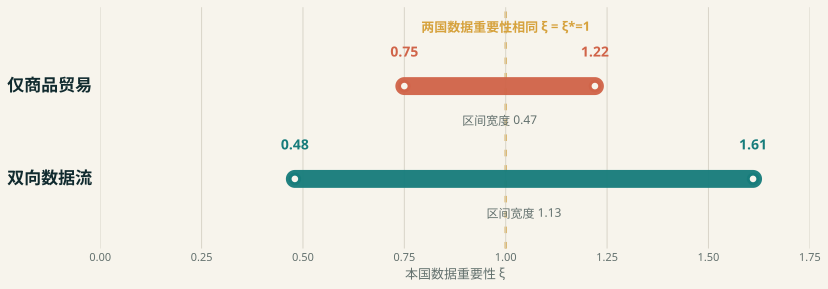
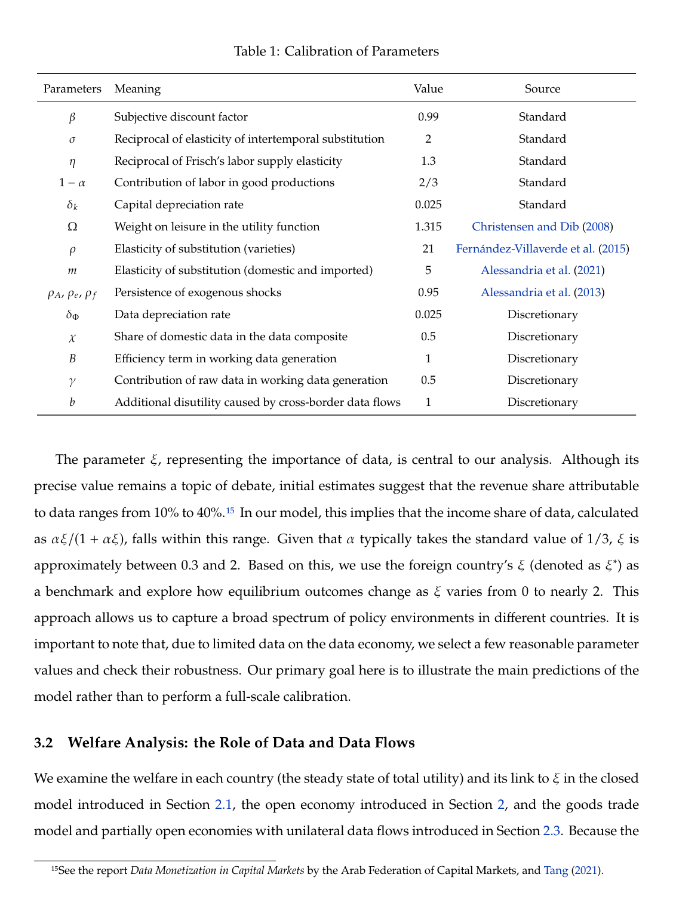
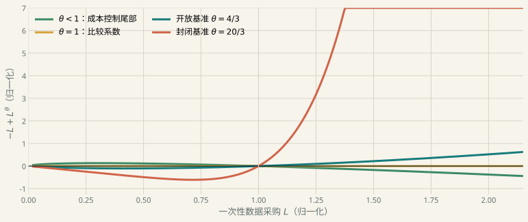
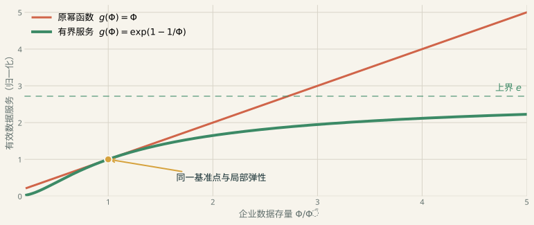

## 跨境数据流把“贸易什么”变成了一个动态问题 {.title-slide #opening}

::: {.title-hero}
::: {}
<p class="eyebrow">CCWZ · Production, Trade, and Cross-Border Data Flows</p>
<h1>跨境数据流把<br>“贸易什么”变成了<br>一个动态问题</h1>
<p class="subtitle">从原始数据、目的地加工到企业数据存量；从作者的福利区间，到企业问题的有限最优反转。</p>
<div class="title-meta"><span>云鹰读书会</span><span>45 分钟主讲 + 15 分钟讨论</span><span>2025-03 NBER 修订版</span></div>
:::
::: {.title-mark}
<svg viewBox="0 0 320 300" aria-hidden="true">
  <path d="M30 210 C90 105 225 95 292 210" fill="none" stroke="#F7F4EC" stroke-width="20" stroke-linecap="round"/>
  <path d="M56 210 C110 132 211 126 266 210" fill="none" stroke="#D6A23D" stroke-width="5" stroke-dasharray="9 10"/>
  <circle cx="66" cy="210" r="22" fill="#177C7B"/><circle cx="254" cy="210" r="22" fill="#D06449"/>
  <rect x="85" y="209" width="24" height="70" fill="#3C8A66"/><rect x="148" y="209" width="24" height="70" fill="#3C8A66"/><rect x="211" y="209" width="24" height="70" fill="#3C8A66"/>
  <circle cx="160" cy="92" r="15" fill="#6956A6"/>
</svg>
<p class="mark-caption">论文搭起了数据经济与国际贸易之间的桥；本报告检查这座桥的机制、收益与承重条件。</p>
:::
:::

::: {.notes}
本报告以 Chang、Cong、Wang、Zhang 的 NBER Working Paper 31416 为对象。版本边界很重要：2023 年是初版，2025 年 3 月是当前 NBER 修订版，2026 AFA 文件是报告材料，不是论文全文。开场先把论文定位成一座桥：它连接了数据来源、加工、使用和商品贸易。后半场再检查这座桥的承重条件。
:::

## 这场报告只回答三个问题 {#questions}

<div class="question-grid">
  <div class="question"><b>01 · MECHANISM</b><strong>数据怎样从消费者活动变成可跨境使用的生产存量？</strong><p>把三个数据对象和五种开放制度讲清。</p></div>
  <div class="question"><b>02 · RESULT</b><strong>为什么数据流能扩大双方都愿意开放的参数区间？</strong><p>把作者的参与约束和定量边界讲清。</p></div>
  <div class="question"><b>03 · AUDIT</b><strong>字面企业合同能否产生有限的数据投资？</strong><p>把独立诊断、三种修复和研究路线讲清。</p></div>
</div>

<div class="slide-source">本项目完整汇报与独立复核；作者结果、独立推导和扩展建议分别标注。</div>

::: {.notes}
这三问也是整套标题链。第一幕从一个路线日志出发，重建模型；第二幕讲作者最重要的福利区间；第三幕用原模型弹性检查企业最优化。之后不把所有缺口一次塞进模型，而是分成合同、信息生产和能力形成三条路线。
:::

## 一条路线日志会经历三次变形 {#three-objects}

<div class="object-flow">
  <div class="data-object" style="color:var(--gold)"><span class="symbol">D<sub>i</sub></span><strong>原始数据</strong><p>消费者活动产生的路线日志、点击或交易记录。</p><span class="label author">来源地</span></div>
  <div class="flow-arrow">→</div>
  <div class="data-object" style="color:var(--violet)"><span class="symbol">φ<sub>ij</sub></span><strong>工作数据</strong><p>用劳动清洗，并针对目的地 j 的生产任务加工。</p><span class="label author">加工地 × 使用地</span></div>
  <div class="flow-arrow">→</div>
  <div class="data-object" style="color:var(--navy)"><span class="symbol">Φ<sub>j,t</sub></span><strong>企业数据存量</strong><p>工作数据流累积、折旧，持续提高企业生产率。</p><span class="label author">使用地 × 时间</span></div>
</div>

<p class="takeaway">把三者混成“数据”，就看不见政策究竟卡在生成、加工，还是企业吸收。</p>

<div class="slide-source">CCWZ 2025 rev., §2, equations (3)–(5), (8)–(11).</div>

::: {.notes}
运行例子是一家跨境物流软件商。用户行程生成原始日志 D；日志不能直接进入生产，要经过清洗和任务适配，成为面向某个使用国的工作数据 φ；企业再把工作数据积累成 Φ。原始数据、工作数据流和企业存量有不同的价格口径和政策暴露。后面所有福利与有限最优判断都依赖这个区分。
:::

## 数据可以复制，但把它变成可用信息仍要花劳动

<div class="copy-contrast">
  <div class="copy-side"><div class="copy-icon">⧉ ⧉ ⧉</div><h3>横向复用接近零复制成本</h3><p>同一份原始记录可以支持多个企业、目的地和任务；这正是数据的非竞争性。</p><span class="label author">Jones–Tonetti → CCWZ</span></div>
  <div class="copy-side cost"><div class="copy-icon">⌁ ⚙</div><h3>清洗与任务适配消耗真实劳动</h3><p>CCWZ 用目的地专用加工把“可复制”与“免费可用”分开，数据贸易因此仍有成本。</p><span class="label author">工作数据生产</span></div>
</div>

<p class="takeaway">非竞争性允许复用；它不等于无限信息，也不会自动给单家企业一个采购上限。</p>

<div class="slide-source">Jones & Tonetti (2020); CCWZ 2025 rev., data producer problem.</div>

::: {.notes}
这里先埋下后半场的关键区分：非竞争性只说明同一记录可被多人同时使用。它不说明无限多的不同信息可以零成本产生，也不说明单个企业的选择集有上界。CCWZ 很好地加入了加工劳动，却没有在企业端把共同数据包或许可容量写进选择集。
:::

## CCWZ 把四个地点和两条跨境流接进同一均衡 {#model-stage}



<p class="stage-hint">点击阶段按钮；演讲模式也可用 Shift + ← / → 推进。打印版显示完整终态。</p>

<div class="slide-source">CCWZ 2025 rev., pp.8–15 and Appendix A.2. 图为本项目按模型方程重绘。</div>

::: {.notes}
按按钮逐步讲。第一步，H、F 的消费者分别产生原始数据。第二步，数据商使用劳动，把同一来源加工成面向不同目的地的工作数据；虚线是跨境数据流。第三步，企业把工作数据变成会折旧的数据存量。第四步，企业生产差异化商品并跨境销售。四个地点是来源地、加工地、使用地和消费地；两条跨境流是工作数据和商品。
:::

## 开放制度不是一个开关，而是五种可比较的组合 {#regimes}

<div class="regime-row">
  <div class="regime"><strong>封闭经济</strong><svg viewBox="0 0 150 90"><circle cx="35" cy="45" r="22" fill="#177C7B"/><circle cx="115" cy="45" r="22" fill="#D06449"/><line x1="62" y1="45" x2="88" y2="45" stroke="#D8D4C8" stroke-width="5" stroke-dasharray="5 5"/></svg><small>商品和数据都不跨境</small></div>
  <div class="regime active-goods"><strong>仅商品贸易</strong><svg viewBox="0 0 150 90"><circle cx="35" cy="45" r="22" fill="#177C7B"/><circle cx="115" cy="45" r="22" fill="#D06449"/><path d="M60 36 H90 M90 54 H60" stroke="#193B58" stroke-width="6"/></svg><small>两向商品；没有数据流</small></div>
  <div class="regime active-data"><strong>F 向 H 流数据</strong><svg viewBox="0 0 150 90"><circle cx="35" cy="45" r="22" fill="#177C7B"/><circle cx="115" cy="45" r="22" fill="#D06449"/><path d="M90 33 H58" stroke="#6956A6" stroke-width="7"/><path d="M60 58 H90" stroke="#193B58" stroke-width="5"/></svg><small>H 进口外国工作数据</small></div>
  <div class="regime active-data"><strong>H 向 F 流数据</strong><svg viewBox="0 0 150 90"><circle cx="35" cy="45" r="22" fill="#177C7B"/><circle cx="115" cy="45" r="22" fill="#D06449"/><path d="M60 33 H92" stroke="#6956A6" stroke-width="7"/><path d="M90 58 H60" stroke="#193B58" stroke-width="5"/></svg><small>F 进口本国工作数据</small></div>
  <div class="regime active-data active-goods"><strong>完全开放</strong><svg viewBox="0 0 150 90"><circle cx="35" cy="45" r="22" fill="#177C7B"/><circle cx="115" cy="45" r="22" fill="#D06449"/><path d="M60 30 H92 M90 45 H58" stroke="#6956A6" stroke-width="6"/><path d="M60 61 H92 M90 75 H58" stroke="#193B58" stroke-width="5"/></svg><small>商品与工作数据双向流动</small></div>
</div>

<div class="slide-source">CCWZ 2025 rev., §2.1–2.3. 单向流按数据进口国标记。</div>

::: {.notes}
五种制度是后面福利比较的基础。第三种表示外国 F 的数据经过加工流入本国 H；第四种反向；第五种双向。不要把“原始数据跨境”与“工作数据跨境”混写。模型中的政策成本主要落在工作数据进口。
:::

## 没有数据流时，能力差距可能让商品贸易失去双方支持 {.compact-title}

```{=html}
<div class="participation">
  <div class="participation-copy"><span class="label author">作者机制</span><h3>开放必须同时满足两国参与约束</h3><p>本国数据重要性 ξ 变化时，贸易条件与生产分工重新分配收益。两国各自相对封闭经济的福利增益都为正，才算可行。</p><p><strong>能力差距过大</strong>时，一国可能获得更廉价商品，另一国却因生产和贸易条件变化而拒绝开放。</p></div>
  <div class="participation-band">
    <div class="band-axis"></div>
    <div class="band home"></div><span class="band-label" style="left:18%;top:42px;color:var(--home)">H 愿意开放</span>
    <div class="band foreign"></div><span class="band-label" style="left:67%;top:198px;color:var(--foreign)">F 愿意开放</span>
    <div class="band overlap"></div><span class="band-label" style="left:45%;top:108px;color:var(--ink)">双方重叠</span>
    <span class="band-label" style="left:4%;top:146px;color:var(--muted)">低 ξ</span><span class="band-label" style="right:2%;top:146px;color:var(--muted)">高 ξ</span>
  </div>
</div>
```

<div class="slide-source">CCWZ 2025 rev., §3.2. 示意图说明参与约束，不重画作者福利水平。</div>

::: {.notes}
这页用参与约束代替一句“贸易有利”。作者比较每国开放福利与各自封闭福利。商品贸易可以提高总量，却不保证两国都愿意参加。数据利用能力 ξ 的差距改变成本、相对价格和贸易条件，因此重叠区间可能很窄。
:::

## 双向数据流扩大双方都愿意开放的能力区间 {#headline-result}

<div class="interval-figure">
  
  <div class="interval-callout"><span class="label author">作者 Table 2</span><strong>0.47 → 1.13</strong><p>当外国 ξ*=1、双向数据进口成本乘数为 1 时，双方贸易可行区间的宽度增加一倍以上。</p><p><strong>[0.75, 1.22]</strong><br>→ <strong>[0.48, 1.61]</strong></p></div>
</div>

<div class="slide-source">CCWZ 2025 rev., Table 2, printed p.21 / PDF p.23. 本项目按表中数值重绘。</div>

::: {.notes}
这是主结果。固定外国数据重要性 ξ*=1。仅商品贸易时，本国 ξ 必须处在 0.75 到 1.22；完全开放且双向数据成本乘数为 1 时，区间变成 0.48 到 1.61。强调这只是作者选定参数下的代表性切片，不是一般阈值定理，也不是经验估计。
:::

## 区间扩大来自新的补偿渠道，不是“开放总是好”

<div class="logic-strip">
  <div class="logic-step"><b>01 · ACCESS</b><strong>数据进口增加可用来源</strong><p>企业不再只靠本国消费者产生的原始数据。</p></div>
  <div class="logic-step"><b>02 · PRODUCTIVITY</b><strong>工作数据积累提高生产率</strong><p>外国来源数据进入复合投入并形成 Φ。</p></div>
  <div class="logic-step"><b>03 · PRICES</b><strong>边际成本与商品价格改变</strong><p>原本不利的一方获得新的生产补偿。</p></div>
  <div class="logic-step"><b>04 · PARTICIPATION</b><strong>两国参与约束同时移动</strong><p>重叠区间扩大，但区间外仍可能有人受损。</p></div>
</div>

<p class="takeaway">数据流的作用是重写分工与补偿；它没有删除隐私成本、贸易条件或能力差距。</p>

<div class="slide-source">CCWZ 2025 rev., Table 2 and surrounding discussion.</div>

::: {.notes}
这个四步链条回答“为什么”。新来源不直接等于福利，它先改变工作数据和数据存量，再进入边际成本与价格，最后移动两国参与约束。反例仍存在：数据进口成本高、隐私成本大或能力差距极端时，开放不会得到双方支持。
:::

## 数据开放还会改变冲击从哪里传来、向哪里扩散

<div class="shock-grid">
  <div class="shock"><span class="label author">生产率冲击</span><div class="shock-path"><div class="shock-node">本国效率 ↑</div><span>→</span><div class="shock-node">进口工作数据 ↑</div><span>→</span><div class="shock-node">Φ 与产出 ↑</div></div><p>开放经济可以从外国补充工作数据；封闭或仅商品贸易模型中，新数据采购可能反向变化。</p></div>
  <div class="shock"><span class="label author">隐私 / 数据成本冲击</span><div class="shock-path"><div class="shock-node">原始供给或进口成本</div><span>→</span><div class="shock-node">来源构成改变</div><span>→</span><div class="shock-node">国际传导方向改变</div></div><p>隐私冲击先作用于本国原始数据；进口成本冲击先作用于外国来源。相同的总流量下降可以来自不同机制。</p></div>
</div>

<div class="slide-source">CCWZ 2025 rev., §4. 本项目未独立复现开放经济 IRFs。</div>

::: {.notes}
这里只报告作者机制，不声称独立复现。生产率冲击会提高企业对数据的边际价值，开放经济可以从国外补数据。隐私冲击和进口成本冲击虽然都可能减少跨境使用，但前者从消费者供数端开始，后者从来源价格开始，政策解释不同。
:::

## CCWZ 的贡献是连接五个环节，而不是发明每个环节 {#literature-bridge}

```{=html}
<div class="literature-river">
  <div class="river-branches">
    <div class="river-branch"><b>NONRIVALRY</b><span>Jones–Tonetti：复用、所有权、隐私</span></div>
    <div class="river-branch"><b>MICRO DATA</b><span>Ichihashi；Acemoglu et al.：披露与外部性</span></div>
    <div class="river-branch"><b>GROWTH</b><span>Cong et al.：研发、知识与纵向复用</span></div>
    <div class="river-branch"><b>INFORMATION</b><span>Farboodi–Veldkamp：存储、折旧与精度边界</span></div>
  </div>
  <div class="bridge-core"><span class="label">CCWZ 的桥</span><h3>原始数据 → 目的地工作数据 → 企业存量 → 商品贸易 → 跨境政策</h3><p>论文最强的贡献是把分散的机制放进同一个两国一般均衡，而不是宣称此前没人研究数据。</p><div class="bridge-links"><div>四个地点可以分开核算</div><div>商品与数据开放可以联合比较</div><div>参与约束可以按国家判断</div></div></div>
</div>
```

<div class="slide-source">Deep-reading matrix D01–D09; CCWZ 2025 rev., introduction.</div>

::: {.notes}
这页收窄贡献主张。Jones–Tonetti 已经有非竞争和所有权；隐私数据市场有更强的微观基础；Cong 系列已有增长；Farboodi–Veldkamp 已有可储存、折旧的数据资产。CCWZ 的新意是国际连接。广义“首次显式建模数据积累”过强，更稳妥的是“首次在跨境生产与贸易中积累目的地专用工作数据”。
:::

## 四组前置文献分别交来了复用、隐私、增长和信息边界

<div class="mechanism-grid">
  <div class="mechanism"><b>JONES–TONETTI</b><h3>横向复用</h3><p>同一数据服务多家企业；所有权决定共享范围。</p><p><strong>CCWZ 保留：</strong>非竞争性。<br><strong>省略：</strong>所有权制度比较。</p></div>
  <div class="mechanism"><b>ICHIHASHI / ACEMOGLU / BBG</b><h3>隐私与相关推断</h3><p>一人的记录会泄露他人信息；中介合同改变补偿。</p><p><strong>CCWZ 保留：</strong>聚合隐私成本。<br><strong>省略：</strong>第三方外部性。</p></div>
  <div class="mechanism"><b>CONG ET AL.</b><h3>创新与知识</h3><p>数据服务研发和当期生产，知识把收益带到未来。</p><p><strong>CCWZ 保留：</strong>动态状态。<br><strong>省略：</strong>内生创新。</p></div>
  <div class="mechanism"><b>FARBOODI–VELDKAMP</b><h3>信息精度边界</h3><p>数据提高预测精度；新增信息在远端自然递减。</p><p><strong>CCWZ 保留：</strong>存储与折旧。<br><strong>省略：</strong>全局饱和。</p></div>
</div>

<div class="slide-source">Jones & Tonetti (2020); Ichihashi (2020, 2021); Acemoglu et al. (2022); Bergemann et al. (2022); Cong et al. (2021, 2022); Farboodi & Veldkamp (2024 rev.).</div>

::: {.notes}
每一列说清“给了什么”和“CCWZ没有保留什么”。这不是说 CCWZ 应该一次吸收全部机制，而是为后面的三条扩展路线建立来源。有限最优修复最直接借助第四列的边际信息递减。
:::

## 后续研究没有沿一条路走，而是向四个边际分叉 {#followup-branches}

```{=html}
<div class="branch-map">
  <div class="branch-root"><strong>CCWZ：生产 × 贸易 × 数据流</strong><p>后续大多继承一个问题或一条渠道，而不是整套企业数据存量结构。</p></div>
  <div class="branch-list">
    <div class="branch"><b>数据类型与增长</b><span>Xie–Zhang；Lee<br>Lee 未引用 CCWZ</span></div>
    <div class="branch"><b>产业组织与协调</b><span>Dubus et al.<br><a href="#/a6-dubus">↗ A6 条件</a></span></div>
    <div class="branch"><b>多国量化政策</b><span>王永进等（2025）<br><a href="#/a7-wang">↗ A7 模型</a></span></div>
    <div class="branch"><b>经验边际</b><span>Liu；Ito；Kässi；Demirer<br><a href="#/a8-identification">↗ A8 识别</a></span></div>
  </div>
</div>
```

<p class="takeaway">“引用 CCWZ”不等于“扩展 CCWZ”；王永进等（2025）直接引用，Lee（2025）不引用。</p>

<div class="slide-source">Deep-reading matrix D10–D18; full-text reference checks.</div>

::: {.notes}
四条分叉要讲关系，不只列题目。Xie–Zhang 引用 CCWZ 但主要延伸 Cong 的增长线；Lee 主题接近，参考文献中没有 CCWZ，Chang et al. 2024 是 Chang–Wu–Zhang。Dubus 明确比较 CCWZ。王永进等 2025 直接引用，但换成 Caliendo–Parro。经验论文测量不同结果。
:::

## “数据效应”至少包含生产率、投入、区位和价值链四个量

<div class="metric-grid">
  <div class="metric"><span class="method">RA / IPW / AIPW DID</span><span class="number">+4–5%<br>+5–6%</span><b>劳动生产率 / TFP</b><p>日本企业开始涉外数据收集；主要在下一年显现。</p></div>
  <div class="metric"><span class="method">DID + SEPARATE IV</span><span class="number">−25%<br>−15%</span><b>存储 / 处理</b><p>GDPR 后欧盟企业；隐含数据成本约 +21%。</p></div>
  <div class="metric"><span class="method">SUN–ABRAHAM EVENT STUDY</span><span class="number">+49%<br>+32%</span><b>下游 / 高 GDP 数据中心开业</b><p>总体平均弱且不精确；区位不等于总算力。</p></div>
  <div class="metric"><span class="method">COUNTRY–INDUSTRY FE</span><span class="number">−0.0385</span><b>价值链稳定</b><p>观察性面板关联；创新作为机制变量。</p></div>
</div>

<div class="slide-source">Ito & Tomiura (2025); Demirer et al. (2026-10 rev.); Kässi & Lehdonvirta (2026-08-25); Liu et al. (2024).</div>

::: {.notes}
不要把四个数字平均成一个“数据开放效应”。Ito 是企业生产率 ATT；Demirer 的 DID 看投入调整，另一个 IV 看生产函数参数；Kässi 看数据中心开业位置；Liu 是固定效应关联。它们可以约束扩展模型，却不直接验证 CCWZ 的 ξ。
:::

## 作者把数字定位为机制展示，而不是结构识别 {#calibration}

<div class="two-col wide-left">
  <div class="source-crop"></div>
  <div><span class="label author">作者原文</span><p class="quote-big">“Our primary goal here is to illustrate the main predictions of the model rather than to perform a full-scale calibration.”<small>数据相关参数部分由作者酌定；跨境数据与增加值测量有限。</small></p></div>
</div>

<div class="slide-source">CCWZ 2025 rev., printed pp.14–15 / PDF pp.16–17, Table 1 and calibration discussion.</div>

::: {.notes}
这页给定量结果正确的证据强度。标准宏观参数来自文献；数据折旧、来源权重、加工效率等包含酌定设定。作者明确说目标是展示主要预测，不是全面校准。因此 Table 2 是机制切片。后续经验数字也不能未经映射直接塞回 ξ。
:::

## 但字面企业合同让数据投资没有有限最大值 {#finite-turn}

<div class="contract-card">
  <div class="contract"><span class="label audit">独立原文审计</span><div class="row"><span>选择变量</span><strong>φ<sub>i,t</sub> ≥ 0</strong></div><div class="row"><span>采购支出</span><strong>P<sub>φ,t</sub> φ<sub>i,t</sub></strong></div><div class="row"><span>状态更新</span><strong>Φ<sub>t+1</sub>=(1−δ)Φ<sub>t</sub>+φ<sub>t</sub></strong></div><div class="row"><span>附录未写</span><strong class="missing">容量 / 固定许可 / 凸安装成本</strong></div></div>
  <div class="tail-warning"><strong>线性成本面对超线性收益</strong><p>固定正价格和正需求，让一家企业一次性买入 L。若未来经营利润的指数 θ&gt;1，企业价值可以沿 L→∞ 不断提高。</p><p>单位测度和非竞争性不会自动缩小单企业的可行集。</p></div>
</div>

<div class="slide-source">CCWZ Appendix A.1–A.2; independent audit in content/有限最优复核与修复.md.</div>

::: {.notes}
条件必须完整说出：固定正价格、固定总需求、单企业可以连续且无上限采购、按线性单位价格付费。附录确实把 φ 列为企业选择并写 Pφφ，没有上限或安装成本。正文“所有企业购买相同数据”也可解释成共同数据包，但那就要把包容量和许可合同显式写入选择集。
:::

## 优化商品产量后，问题只剩一个尾部指数 {#theta-derivation}

::: {.equation-stack}
::: {.equation-box}
**01 · 技术**

$$y=A\Phi^{\alpha\xi}k^\alpha n^{1-\alpha}$$

固定 $\Phi$，边际成本按 $\Phi^{-\alpha\xi}$ 下降。
:::
<div class="equation-arrow">→</div>
::: {.equation-box}
**02 · CES 定价**

$$\pi^{op}(\Phi)=C\Phi^{\alpha\xi(e-1)}$$

$e=\rho$（封闭）；$e=m$（开放）。
:::
<div class="equation-arrow">→</div>
::: {.equation-box .theta-final}
**03 · 尾部指数**

$$\boxed{\theta=\alpha\xi(e-1)}$$

一次偏离：$-qL+\beta C L^\theta$。
:::
:::

<div class="slide-source">Independent derivation from CCWZ demand and production; SymPy verifies the general exponent a(e−1).</div>

::: {.notes}
不需要求整个一般均衡。先固定价格和需求，对商品产量做最优化。边际成本随 Φ 的指数是负 αξ；CES 加成和需求把最优经营利润放大为 αξ(e−1)。再构造一次性偏离：今天付线性成本 qL，明天至少获得 βCL^θ。只要 θ>1，尾部无上界。
:::

## 基准指数在封闭和开放经济都大于 1 {#theta-explorer-slide}



<div class="slide-source">Calibration: α=1/3, ξ=1, ρ=21, m=5. Curve is normalized to show tail order, not an author quantitative result.</div>

::: {.notes}
先点封闭经济：θ=20/3，ξ 只要超过 0.15 就超线性；基准 ξ=1 远超临界。再点开放经济：θ=4/3，临界 ξ=0.75，基准也超线性。可拖动 ξ 看阈值。图用归一化 −L+L^θ，目的只在阶数；不是作者的金额或采购量。
:::

## 一阶条件的正根反而是局部最小值

<div class="minimum-grid">
  
  <div class="minimum-proof"><span class="label audit">为什么求解器会误导</span>

$$f(L)=-qL+\beta C L^\theta$$

$$q=\beta C\theta L^{\theta-1}$$

$$f''(L)=\beta C\theta(\theta-1)L^{\theta-2}>0$$

<p>当 θ&gt;1，正驻点是谷底；稳态算法收敛到一阶条件根，不等于企业取得有限最大值。</p></div>
</div>

<div class="slide-source">Independent proof; numerical curves are normalized illustrations. Full deviation proof in A4.</div>

::: {.notes}
这一页专门阻止常见误解。对超线性目标，一阶条件仍可能有正根，但二阶导为正。求解器看到的是一个局部最小值。完整动态模型即使有稳态方程的数值解，也不能替代单企业全局最优化存在性。
:::

## 三种闭合方式修的是三个不同对象 {#repairs}

<div class="repair-three">
  <div class="repair"><span class="repair-id">TECHNOLOGY</span><h3>有界有效数据服务</h3><p>把 $\Phi^\xi$ 换成在基准附近同弹性、远端饱和的 $g(\Phi)$。</p><span class="changes">改变：数据如何成为生产服务</span></div>
  <div class="repair"><span class="repair-id">CONTRACT</span><h3>有限数据包 / 授权容量</h3><p>写出 $0\le\varphi_i\le\bar\varphi$，或用固定接入费购买共同数据包。</p><span class="changes">改变：企业可行集与价格合同</span></div>
  <div class="repair"><span class="repair-id">ABSORPTION</span><h3>足够凸安装成本</h3><p>治理、清洗、接口和权限使吸收成本的尾部阶数超过收益。</p><span class="changes">改变：企业侧真实资源成本</span></div>
</div>

<p class="takeaway">三种方案都能闭合，却不能在方程旁加一句话后继续沿用原均衡条件。</p>

<div class="slide-source">Independent repair designs; not CCWZ author results.</div>

::: {.notes}
推荐顺序：有界服务作为新基准；有限授权用于合同与制度研究；凸成本做稳健性。有限授权最贴近“相同数据包”文字，但必须重写数据商收入和企业 Kuhn–Tucker 条件。凸成本要足够高阶，在封闭基准中成本指数须超过 20/3，数值上可能很强。
:::

## 有界有效数据服务最适合作为基准修复 {#bounded-service}

<div class="two-col wide-left">
  
  <div><span class="label extension">推荐修复</span>

$$g(\Phi)=\bar g\exp\left\{\frac{\xi}{\kappa}\left[1-\left(\frac{\Phi}{\bar\Phi}\right)^{-\kappa}\right]\right\}$$

<p class="small"><strong>在 $\bar\Phi$：</strong>水平和局部弹性仍是原校准。<br><strong>当 $\Phi\to\infty$：</strong>服务上界有限，线性采购成本最终占优。</p></div>
</div>

<div class="slide-source">Independent proposal motivated by Farboodi–Veldkamp's diminishing informational gains.</div>

::: {.notes}
图中取 ξ=κ=1、基准 Φ̄=1 归一化。绿线与原幂函数在基准点水平相同、局部弹性相同，但远端趋于 e。一般函数的上界是 ḡ exp(ξ/κ)。这保留作者稳态附近希望 ξ 表示的机制，却不让远端无限维持同一幂弹性。
:::

## 修复保留局部机制，却要求重新计算所有福利区间

<div class="keep-recompute">
  <div class="ledger"><span class="label extension">可以保留</span><h3>论文的问题与局部逻辑</h3><ul><li>原始 / 工作 / 存量三分法</li><li>加工劳动与目的地适配</li><li>商品和数据联合开放</li><li>能力差距移动参与约束</li></ul></div>
  <div class="ledger recompute"><span class="label audit">必须重算</span><h3>定量均衡与政策数字</h3><ul><li>数据 Euler 与稳态使用者成本</li><li>数据价格、供给与加工劳动</li><li>五种制度的福利区间</li><li>IRFs 与最优政策</li></ul></div>
</div>

<p class="takeaway">闭合修复救的是模型一致性；它不替原来的 Table 2 自动背书。</p>

<div class="slide-source">Independent audit. No repaired general-equilibrium welfare replication is claimed.</div>

::: {.notes}
这里给 balanced judgment。不能因为发现有限最优问题就丢掉整篇论文；也不能因为修复在局部保留弹性，就继续引用原福利数字。正确研究顺序是重新标定封闭经济，再恢复商品贸易、单向数据流和双向开放。
:::

## 现实扩展也要分开：合同、信息生产、能力形成 {#routes-slide}

<div class="route-three">
  <div class="research-route"><b>ROUTE A</b><h3>安全许可与合规</h3><p>把数据类别、用途、接收方、期限和安全义务写进授权集合；区分固定审核与单位处理成本。</p><a href="#/a5-lean">合同闭合 ≠ Lean 证明</a></div>
  <div class="research-route"><b>ROUTE B</b><h3>质量、饱和与算力</h3><p>用 $g(\Phi,Q,C)$ 区分数量、信息质量和算力；吸收 Demirer 的互补性与 Farboodi–Veldkamp 的饱和。</p><a href="#/a8-identification">↗ 经验参数边界</a></div>
  <div class="research-route"><b>ROUTE C</b><h3>训练、研发与能力</h3><p>增加研发劳动、能力状态或新品种，区分今天的生产率与未来的学习、创新和追赶。</p><a href="#/a9-corpus">↗ 证据边界</a></div>
</div>

<div class="slide-source">Project synthesis from the deep-reading matrix and routes A/B/C.</div>

::: {.notes}
不要把三条路线一次塞进新模型。A 回答“谁能以什么条件使用什么数据”；B 回答“更多数据如何成为有效信息”；C 回答“数据如何形成长期能力”。每条路线有不同的可识别对象和政策问题。
:::

## 开放、许可和吸收能力必须一起设计 {#policy}

```{=html}
<div class="policy-triangle">
  <svg viewBox="0 0 500 440" role="img" aria-label="开放、许可与吸收能力构成政策三角">
    <path d="M250 55 L68 360 L432 360 Z" fill="none" stroke="#193B58" stroke-width="9"/>
    <circle cx="250" cy="55" r="42" fill="#177C7B"/><circle cx="68" cy="360" r="42" fill="#6956A6"/><circle cx="432" cy="360" r="42" fill="#D06449"/>
    <text x="250" y="62" text-anchor="middle" fill="white" font-size="25" font-weight="700">开放</text>
    <text x="68" y="367" text-anchor="middle" fill="white" font-size="25" font-weight="700">许可</text>
    <text x="432" y="367" text-anchor="middle" fill="white" font-size="23" font-weight="700">能力</text>
    <text x="250" y="238" text-anchor="middle" fill="#102A2E" font-size="27" font-weight="700">可执行的福利比较</text>
  </svg>
  <div class="policy-list">
    <div class="policy-point"><b>只有开放，没有许可</b><span>流量上升，却无法判断用途、风险和合同是否闭合。</span></div>
    <div class="policy-point"><b>只有许可，没有吸收能力</b><span>合法取得的数据不一定转化成有效生产率。</span></div>
    <div class="policy-point"><b>只有境内投资，没有总量核算</b><span>数据中心回流可以与全球总算力下降同时发生。</span></div>
  </div>
</div>
```

<div class="slide-source">Synthesis from CCWZ, privacy-contract literature, Demirer et al., and Kässi–Lehdonvirta.</div>

::: {.notes}
政策不能只盯跨境流量。开放决定可达性，许可决定可执行的使用权和安全条件，吸收能力决定数据能否成为有效信息。Kässi 的结果提醒：境内设施上升不等于总投入上升；Ito 提醒收益有时滞；Demirer 提醒数据和算力是强互补。
:::

## 保留这座桥，但要补上它的承重结构 {#closing}

<div class="closing-bridge">
  <div><span class="section-kicker">TAKEAWAY</span><h2>保留这座桥，<br>但要补上它的承重结构</h2><p class="muted">CCWZ 最有价值的部分，是连接数据链和贸易链。用于定量政策之前，企业合同需要闭合；用于现实扩展时，许可、信息饱和和能力形成必须分开建模。</p><div class="rule"></div><p><span class="label author">保留机制</span> <span class="label audit">修复最优化</span> <span class="label extension">分路线扩展</span></p></div>
  <div class="bridge-visual"><div class="bridge-deck"></div><div class="bridge-pier a"></div><div class="bridge-pier b"></div><div class="bridge-pier c"></div></div>
</div>

<div class="slide-source">完整材料：docs/index.html · 深读矩阵 · 有限最优复核 · Quarto appendix side rooms.</div>

::: {.notes}
结束时回到桥的比喻。评价不是“模型错误所以无用”，也不是“有稳态所以没问题”。保留连接机制，补上企业问题，再按合同、信息生产和能力形成分别扩展。接下来可以进入讨论，或从分支页进入附录。
:::

## 三个数据对象各有一条方程和一个价格口径 {#a1-notation .appendix}

<a class="return-link" href="#/three-objects">← 回到主线</a>
<span class="appendix-tag">A1 · NOTATION</span>

| 对象 | 生成 / 更新 | 价格与政策口径 | 不能混写成 |
|---|---|---|---|
| 原始数据 $D_i$ | 消费活动产生；家庭承受隐私成本 | 家庭向数据商供数的价格 | 跨境流量本身 |
| 工作数据 $\varphi_{ij}$ | 原始数据 + 加工劳动；目的地专用 | 企业按 $P_{\varphi,j}$ 采购；进口成本作用于来源组合 | 企业历史存量 |
| 企业存量 $\Phi_{j,t}$ | $\Phi_{t+1}=(1-\delta_\Phi)\Phi_t+\varphi_t$ | 影子价值进入动态 Euler | 当期传输字节数 |

<p class="takeaway">规则指数、传输流量和有效信息存量需要一条测量方程才能连接。</p>

<div class="slide-source">CCWZ §2 and Appendix A; terminology audit.</div>

::: {.notes}
这是问答备用。原始数据价格、工作数据价格和企业状态影子价值不是同一个价格。现实的规则指数也不是模型 φ，需要测量方程。
:::

## 五种开放制度改变的是不同的箭头 {#a2-regimes .appendix}

<a class="return-link" href="#/regimes">← 回到主线</a>
<span class="appendix-tag">A2 · REGIMES</span>

| 制度 | 商品 H↔F | 数据 H→F | 数据 F→H | 主要比较 |
|---|:---:|:---:|:---:|---|
| 封闭 | — | — | — | 各国参与约束的基准 |
| 仅商品贸易 | ✓ | — | — | 商品分工本身是否双方获益 |
| F 进口数据 | ✓ | ✓ | — | 外国是否因取得本国工作数据而补偿 |
| H 进口数据 | ✓ | — | ✓ | 本国是否因取得外国工作数据而补偿 |
| 完全开放 | ✓ | ✓ | ✓ | 数据来源替代与双边参与区间 |

<p class="small muted">CCWZ 还改变商品进口成本、数据进口成本和能力参数，构造政策组合与不对称国家。</p>

<div class="slide-source">CCWZ §2.3 and Table 2.</div>

::: {.notes}
如果听众对单向箭头混淆，用这张表澄清。行名按进口国而不是出口国更容易口头表达。
:::

## Table 2 的完整区间比一个标题数字更丰富 {#a3-table2 .appendix .full-table}

<a class="return-link" href="#/headline-result">← 回到主线</a>
<span class="appendix-tag">A3 · AUTHOR TABLE 2</span>

<div class="two-col align-start">
<div>

**双方愿意进行商品贸易：本国 $\xi$ 区间**

| 模型 | $\xi^*=0.5$ | $\xi^*=1.0$ | $\xi^*=1.5$ |
|---|---:|---:|---:|
| 仅商品贸易 | [0, 0.79] | [0.75, 1.22] | [1.31, 1.67] |
| F 进口数据 | [0, 0.80] | [0.47, 1.27] | [0.88, 1.75] |
| H 进口数据 | [0, 1.03] | [0.72, 1.75] | [1.23, 1.75] |
| 双向，$d_D^*=1$ | [0, 1.02] | [0.48, 1.61] | [0.93, 1.75] |
| 双向，$d_D^*=1.5$ | [0, 0.91] | [0.49, 1.39] | [0.94, 1.75] |
| 双向，$d_D^*=2$ | [0, 0.87] | [0.50, 1.33] | [0.96, 1.75] |

</div>
<div>

**双方愿意发生正数据流：本国 $\xi$ 区间**

| 模型 | $\xi^*=0.5$ | $\xi^*=1.0$ | $\xi^*=1.5$ |
|---|---:|---:|---:|
| F 进口数据 | [0, 0.73] | [0.47, 1.19] | [0.88, 1.61] |
| H 进口数据 | [0.29, 1.03] | [0.78, 1.75] | [1.37, 1.75] |
| 双向，$d_D^*=1$ | [0.13, 1.02] | [0.48, 1.61] | [0.93, 1.75] |
| 双向，$d_D^*=1.5$ | [0.15, 0.91] | [0.49, 1.39] | [0.94, 1.75] |
| 双向，$d_D^*=2$ | [0.17, 0.87] | [0.50, 1.33] | [0.96, 1.75] |

</div>
</div>

<div class="slide-source">CCWZ 2025 rev., Table 2. $d_D=1$ in the home country; only $\xi,\xi^*\in[0,1.75]$ displayed.</div>

::: {.notes}
主线只用了 ξ*=1 的商品贸易可行区间。完整表还区分“双方愿意贸易”和“双方愿意发生正数据流”，并改变外国数据进口成本。进口成本升高时，完全开放区间收窄。
:::

## 一次性偏离已经足以证明尾部无上界 {#a4-proof .appendix}

<a class="return-link" href="#/finite-turn">← 回到主线</a>
<span class="appendix-tag">A4 · COMPLETE TAIL ARGUMENT</span>

$$\pi^{op}(\Phi)=C\Phi^\theta,\qquad \theta=\alpha\xi(e-1),\ C>0.$$

今天买入 $L$，下一期 $\Phi_{t+1}\ge L$；以后可选择不生产。偏离价值至少为

$$-P_{\varphi,t}L+\beta C L^\theta.$$

<div class="proof-cases">
  <div class="proof-case"><h3>θ &lt; 1</h3><p>线性成本控制尾部；还需连续性、折现和状态可行性保证最大值存在。</p></div>
  <div class="proof-case"><h3>θ = 1</h3><p>比较 $\beta C$ 与 $P_\varphi$；正、负、相等分别对应无界、受控和尾部平坦。</p></div>
  <div class="proof-case"><h3>θ &gt; 1</h3><p>超线性收益压过线性成本，极限为 $+\infty$；不存在有限数值的最大化解。</p></div>
</div>

<div class="slide-source">Independent proof. Fixed positive prices and demand; continuous unbounded purchase set.</div>

::: {.notes}
一次性偏离避免处理完整动态路径。下一期数据存量至少是 L，经营利润至少是 CL^θ。企业之后可以停产，所以这确实是价值下界。θ<1 只排除这类尾部偏离，不自动证明完整动态问题存在最优。
:::

## Lean 证明的是多项式尾部，不是整个经济模型 {#a5-lean .appendix}

<a class="return-link" href="#/theta-explorer-slide">← 回到主线</a>
<span class="appendix-tag">A5 · FORMAL BOUNDARY</span>

<div class="two-col wide-right">
  <div class="formal-box"><strong>open_profit_unbounded</strong><br>∀ M, ∃ x≥0,<br>M &lt; A·x⁴ − q·x³<br><br><strong>closed_profit_unbounded</strong><br>∀ M, ∃ x≥0,<br>M &lt; A·x²⁰ − q·x³<br><br>with A&gt;0 and Φ=x³</div>
  <div><h3>Lean 排除代数跳步</h3><p class="small">$\Phi^{4/3}=x^4$，$\Phi^{20/3}=x^{20}$，因此两个基准尾部都无上界。</p><h3>经济映射仍由人工承担</h3><p class="small">需求是否固定、价格是否为单位价格、合同是否无上限、企业测度如何处理，都没有被这两个定理形式化。</p></div>
</div>

<div class="slide-source">Lean 4.34.1 + mathlib 4.34.1; verification/lean/CCWZFiniteOptimum/Basic.lean.</div>

::: {.notes}
形式化验证的边界要主动说清。Lean 证明的是抽象多项式命题。它不能替代从 CCWZ 的需求、生产、合同到多项式的映射。项目已通过 lake build。
:::

## Dubus 的协调结论在 CES 下恰好消失 {#a6-dubus .appendix}

<a class="return-link" href="#/followup-branches">← 回到主线</a>
<span class="appendix-tag">A6 · CONDITIONAL COORDINATION</span>

<div class="two-col">
  <div><span class="label author">CES</span><h3>外国开放不改变本国福利</h3>

$$U_i=\frac{L_i}{c-\delta_i f}\frac{\sigma-1}{\sigma}\left(\frac{1}{\sigma f}\sum_jL_j\right)^{1/(\sigma-1)}$$

$$\frac{\partial U_i}{\partial\delta_j}=0$$

<p class="small muted">网络收益、单品消费和品种减少正好抵消；不需要国际协调。</p></div>
  <div><span class="label extension">可变替代弹性</span><h3>品种减少会改变市场势力</h3><p class="small">当 σ′(N) &gt; 0 且进入成本足够高，外国开放减少品种并伤害本国消费者；纳什开放超过协调最优。</p><p class="takeaway">协调是需求曲率 × 进入条件的结果。</p></div>
</div>

<div class="slide-source">Dubus et al. (2026-01-14), equation (12), Lemma 7, Proposition 2.</div>

::: {.notes}
这页用来阻止把“协调必要”无条件推广。CES 是刀刃情形，但它明确显示结果对需求系统敏感。可变替代弹性下，品种减少不仅是 love-of-variety，还改变竞争强度。
:::

## 王永进等继承政策问题，却换成外部规模的量化贸易模型 {#a7-wang .appendix}

<a class="return-link" href="#/followup-branches">← 回到主线</a>
<span class="appendix-tag">A7 · CLOSE QUANTITATIVE FOLLOW-UP</span>

<div class="two-col wide-left">
  <div><h3>Caliendo–Parro 骨架</h3>

$$q_n^j(\omega)=z_n^j(\omega)(D_n^j)^{\psi_j}\,[q_{Vn}^j]^{\gamma_{Vn}^j}\prod_k[m_{n}^{kj}]^{\gamma_n^{kj}}$$

<p class="small">38 国 × 44 行业；行业销售形成数据规模；$\kappa_{in}$ 决定跨境数据可用比例。参考文献 [10] 直接引用 CCWZ，但没有企业 $\Phi$ 或动态 Euler。</p></div>
  <div><div class="metric" style="min-height:auto;border-color:var(--foreign)"><span class="method">行业 ψ<sub>j</sub> 基准</span><span class="number">−0.01%<br>−0.37%<br>−0.17%</span><b>GDPR：中 / EU均值 / 全球均值</b><p>中国最优扶持后本国 +0.07%。统一 ψ=0.14 的示意最大增益为 6.28%。</p></div></div>
</div>

<div class="slide-source">王永进、王文斌、谢芳（2025），《金融研究》(9):77–95，官方全文 pp.5–17.</div>

::: {.notes}
政策情景 κ_EU,n=0.7，κ_US,CN=0。贸易弹性 5.03，需求弹性 4，资本劳动替代参数 0.3。ψ_j 由“数据行业”投入系数代理，因此数值是帽子代数反事实，不是因果估计。
:::

## 四组经验结果来自四套不同识别设计 {#a8-identification .appendix .identification-table}

<a class="return-link" href="#/followup-branches">← 回到主线</a>
<span class="appendix-tag">A8 · IDENTIFICATION MAP</span>

| 论文 | 处理 / 变异 | 结果 | 设计 | 能约束什么 | 不能证明什么 |
|---|---|---|---|---|---|
| Ito–Tomiura | 2021 开始涉外数据收集 | LP、TFP | 单队列 RA/IPW/AIPW DID | 企业生产率量级与时滞 | CCWZ 的 $\xi$ |
| Demirer et al. | GDPR × EU 企业 | 存储、处理 | DID / event study | 监管后的投入调整 | 生产函数弹性 |
| Demirer et al. | 行业数据强度 × 云价变异 | 数据—算力投入 | shift-share IV | CES 替代弹性 0.33–0.44 | GDPR 的处理效应 |
| Kässi–Lehdonvirta | 首次 GDPR 级规则 | 数据中心开业 | Sun–Abraham event study | 区位与合规配额渠道 | 总算力或福利必然上升 |
| Liu et al. | RCDF 指标跨国跨行业变化 | 价值链稳定 | 国家/行业/年份 FE | 观察性关联与机制异质性 | 随机因果效应 |

<div class="slide-source">Full-text method and results sections; see research/deep-reading-matrix.csv.</div>

::: {.notes}
Demirer 必须占两行，因为 DID 和 shift-share IV 回答不同问题。Ito 的 AIPW 具有双重稳健性，但仍依赖至少一个模型正确和条件平行趋势。Kässi 做了多种稳健性与安慰剂，法律采用仍不是随机。
:::

## 25 份 PDF 不等于 25 篇逐页全文审计 {#a9-corpus .appendix}

<a class="return-link" href="#/routes-slide">← 回到主线</a>
<span class="appendix-tag">A9 · EVIDENCE DEPTH</span>

<div class="corpus-bars">
  <div class="corpus-bar" style="height:90px"><b>1</b><span>模型审计</span></div>
  <div class="corpus-bar" style="height:90px"><b>1</b><span>全文通读</span></div>
  <div class="corpus-bar" style="height:260px"><b>15</b><span>聚焦全文</span></div>
  <div class="corpus-bar" style="height:72px"><b>1</b><span>节读</span></div>
  <div class="corpus-bar" style="height:130px"><b>5</b><span>待读</span></div>
  <div class="corpus-bar" style="height:72px"><b>1</b><span>版本比较</span></div>
</div>

<p class="center"><span class="big-number">1,012</span> 页已登记；另有 1 份五页发现稿被 19 页官方全文替代。</p>
<p class="small muted center">A1 = 模型 / 识别设计全文复核；A2 = 聚焦全文；B = 官方摘要或书目。文本提取本身不提高证据等级。</p>

<div class="slide-source">research/paper-corpus-manifest.csv; deep-reading-matrix.csv.</div>

::: {.notes}
柱状图用当前状态。模型审计是 CCWZ；全文通读是王永进等 2025；15 篇聚焦全文；1 篇综述节读；5 篇仅排队；1 篇版本比较。还有 P23 被官方全文替代，不在柱状图主状态中。
:::

## 参考文献与版本记录 {#a10-references .appendix}

<a class="return-link" href="#/closing">← 回到结论</a>
<span class="appendix-tag">A10 · REFERENCES</span>

<div class="references-list">
<p><strong>Chang, Cong, Wang & Zhang.</strong> 2023; rev. Mar. 2025. <em>Production, Trade, and Cross-Border Data Flows.</em> NBER WP 31416.</p>
<p><strong>Jones & Tonetti.</strong> 2020. “Nonrivalry and the Economics of Data.” <em>AER</em> 110(9).</p>
<p><strong>Ichihashi.</strong> 2020. “Online Privacy and Information Disclosure by Consumers.” <em>AER</em> 110(2); 2021. “The Economics of Data Externalities.” <em>JET</em> 196.</p>
<p><strong>Acemoglu, Makhdoumi, Malekian & Ozdaglar.</strong> 2022. “Too Much Data.” <em>AEJ Micro</em> 14(4).</p>
<p><strong>Bergemann, Bonatti & Gan.</strong> 2022. “The Economics of Social Data.” <em>RAND Journal of Economics</em>.</p>
<p><strong>Cong, Xie & Zhang.</strong> 2021. “Knowledge Accumulation, Privacy, and Growth in a Data Economy.” <em>Management Science</em>.</p>
<p><strong>Cong, Wei, Xie & Zhang.</strong> 2022. “Endogenous Growth under Multiple Uses of Data.” <em>JEDC</em> 141.</p>
<p><strong>Farboodi & Veldkamp.</strong> Local revision 9 Jul. 2024. <em>A Model of the Data Economy.</em> NBER WP 28427 series.</p>
<p><strong>Xie & Zhang.</strong> 2024. <em>A Generalized Model of Growth in the Data Economy.</em> Preprint v1.</p>
<p><strong>Lee.</strong> 2025. <em>Trade and Growth with Digital Data.</em> KIEP WP 25-02.</p>
<p><strong>Liu, Zhang, Jiang & Cheng.</strong> 2024. “Limiting Heterogeneity in Cross-Border Data Flow.” <em>PLOS ONE</em> 19(8).</p>
<p><strong>王永进、王文斌、谢芳.</strong> 2025.《跨境数据流动壁垒对中国的影响及反制战略》。《金融研究》(9):77–95.</p>
<p><strong>Dubus, Köthenbürger, Parenti & Ushchev.</strong> 14 Jan. 2026. <em>Trade in Data.</em> Working paper.</p>
<p><strong>Ito & Tomiura.</strong> Dec. 2025. <em>The Productivity Effects of Cross-border Data Flows.</em> RIETI DP 25-E-125.</p>
<p><strong>Kässi & Lehdonvirta.</strong> 25 Aug. 2026. <em>The Heterogeneous Impact of Data Transfer Restrictions on Data Centre Geography.</em></p>
<p><strong>Demirer, Jiménez-Hernández, Li & Peng.</strong> Local revision Oct. 2026. <em>Data, Privacy Laws and Firm Production.</em> NBER WP 32146 series.</p>
</div>

<div class="slide-source">Full source ledger and page-level evidence: research/source-ledger.csv and research/deep-reading-matrix.csv.</div>

::: {.notes}
版本日期按本项目实际核验文本记录。工作论文不写成已发表成果。完整 URL 和证据位置在 source ledger。
:::
